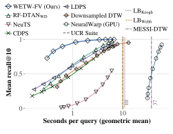
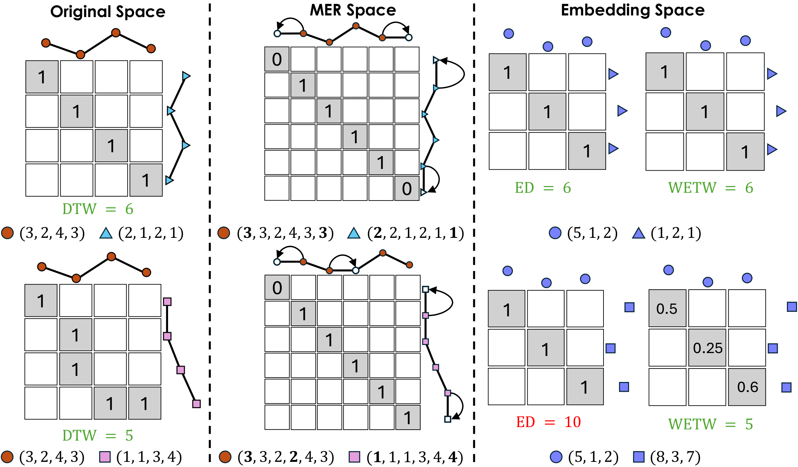
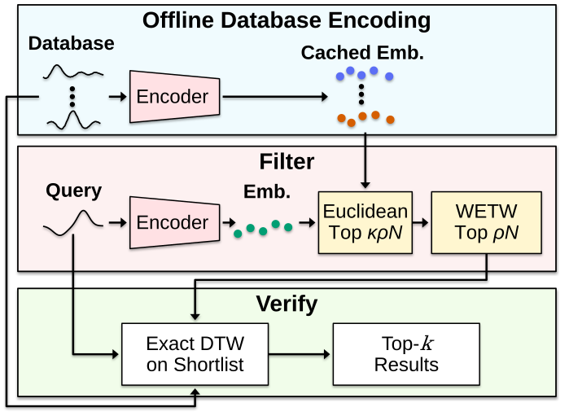
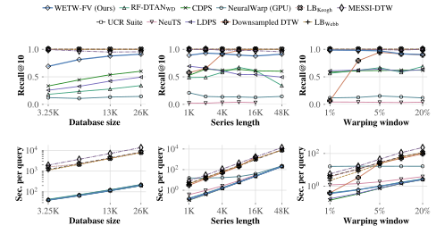

<div align="center">

# WETW
### Learning Pair-Specific Weighted Euclidean Distances for Efficient DTW Search

**Christos Panourgias**<sup>1</sup> · **Qitong Wang**<sup>2</sup> · **George Tzagkarakis**<sup>3</sup> · **Themis Palpanas**<sup>1</sup>

<sup>1</sup>Université Paris Cité, LIPADE &nbsp; <sup>2</sup>Harvard University &nbsp; <sup>3</sup>FORTH-ICS

[](pyproject.toml)
[](pyproject.toml)
[](src/wetw/conf)
[](LICENSE)

[Quick start](#quick-start) · [Pretrained model](#use-a-pretrained-model) · [Reproduce the paper](#reproduce-the-paper) · [Documentation](docs/reproduction.md)

</div>

---

**WETW** (**W**eighted **E**uclidean **T**ime **W**arping) approximates DTW with a learned distance between time-series embeddings. A small symmetric network predicts positive coordinate weights for each pair. **WETW-FV** uses this distance to select a shortlist, then verifies its candidates with exact DTW.

> Learn which candidates to check, and spend exact DTW computation on those candidates.

<p align="center">
  <a href="assets/results.pdf"></a>
</p>
<p align="center"><em>Complete search, averaged over eight collections. WETW-FV retrieves more true neighbours at the same query time.</em> &nbsp; <a href="assets/results.pdf">PDF</a></p>

## Contents

- [Highlights](#highlights)
- [Why WETW?](#why-wetw)
- [How it works](#how-it-works)
- [Results](#results)
- [Quick start](#quick-start)
- [Install](#install)
- [Use a pretrained model](#use-a-pretrained-model)
- [Step by step](#step-by-step)
- [Reproduce the paper](#reproduce-the-paper)
- [Tests](#tests)
- [Repository layout](#repository-layout)
- [Citation](#citation)

---

## Highlights

- **Fast complete search.** Over eight collections, WETW-FV runs **11.4×** faster than the fastest exact search among the UCR Suite, single lower bounds and MESSI-DTW, at a mean recall@10 of **0.93**. The strongest learned baseline reaches **0.59** at the same speed.
- **Long series.** On 26K series of 48K points, WETW-FV is **40×** faster than the UCR Suite at a recall@10 of **0.91**.
- **Pair-specific weights.** On the same frozen embeddings, WETW halves the distance error of the best static measure (**0.04** against 0.08).
- **Ranking-aware supervision.** Regression alone misorders the closest neighbours; ranking regularization raises recall@1 from 0.79 to **0.95** and helps every encoder.
- **Temporal features.** At matched capacity, WESee's Temporal Feature Extractor raises recall@1 from 0.90 to **0.95**.
- **A small comparison network.** The default generator has **65,793 parameters**, including the learned distance scale; database embeddings are computed once and cached.
- **Works with other encoders.** Use the supplied **WESee** encoder or train WETW on another encoder's embeddings.

## Why WETW?

DTW handles temporal misalignment, but comparing a query with every database series is expensive. Learned embeddings make comparisons cheaper; the comparison rule also needs to preserve the neighbours that DTW would return.

| Approach | Strength | Limitation |
|---|---|---|
| Exact DTW search with bounds or an index | Exact neighbours and distances | Expensive when pruning leaves substantial DTW work |
| Embeddings with a fixed distance | Cheap candidate ranking | Can lose DTW neighbours |
| **WETW-FV** | **Learned ranking followed by exact verification** | Shortlist size controls the recall–latency trade-off |

<p align="center">
  <a href="assets/motivation.pdf"></a>
</p>
<p align="center"><em>DTW adapts an alignment to each pair. WETW learns pair-specific weights over embedding coordinates.</em> &nbsp; <a href="assets/motivation.pdf">PDF</a></p>

## How it works

<p align="center">
  <a href="assets/architecture.pdf"></a>
</p>
<p align="center"><em>Left: WESee encoder. Right: the weight generator and weighted comparison.</em> &nbsp; <a href="assets/architecture.pdf">PDF</a></p>

**Encode.** WESee combines a residual convolutional backbone with a global summary and a multi-scale Temporal Feature Extractor. Each series becomes a fixed-size embedding, $\mathbf e_i$.

**Compare.** Symmetric pair features—absolute differences, products and sums—feed a two-layer MLP. Its positive weights define

$$
\widehat d_{ij}=s\sqrt{\sum_{k=1}^{d}w_{ij,k}(e_{i,k}-e_{j,k})^2}.
$$

**Train.** Training has three stages. (i) The encoder warms up on the MSE between Euclidean embedding distances and DTW targets. (ii) Encoder and generator train jointly with $\mathcal{L}_{\mathrm{WD}}$, a relative-error regression on DTW distances (`warpdistill` in the code). (iii) Ranking supervision is added: the encoder is first refined for up to 3K updates with the Euclidean distance, then frozen while the generator is refined on its stored embeddings with a cosine learning rate.

**Search.** WETW-FV uses three stages:

1. **Prefilter:** rank cached database embeddings by Euclidean distance.
2. **Rescore:** apply WETW to the closest $\kappa\rho N$ series and keep the best $\rho N$ as the shortlist; $\kappa$ is chosen on validation data.
3. **Verify:** compute exact DTW on the shortlist and return its nearest candidates.

<p align="center">
  <a href="assets/pipeline.pdf"></a>
</p>
<p align="center"><em>Database encoding is offline; query time includes ranking and verification.</em> &nbsp; <a href="assets/pipeline.pdf">PDF</a></p>

Every returned distance is exact. A neighbour can be missed if it is excluded from the shortlist; a full shortlist recovers exact search. WETW is symmetric and non-negative, but does not require the triangle inequality.

## Results

**Setup.** Eight real collections, databases of **20.9K–840K** series and series of 256 to 5,000 points, with **100 held-out search queries** per collection, plus AudioMNIST series of up to 48K points for scalability. The comparisons below are reported paper results.

| Comparison | Reference | WETW / WETW-FV |
|---|---:|---:|
| Mean absolute relative distance error, frozen WESee embeddings, regression only | Best static measure: 0.08 | **0.04** |
| Mean recall@1 at a 2% shortlist, with ranking regularization | Euclidean: 0.85 | **0.95** |
| Mean recall@10 in complete search, matched query speed | Best learned baseline: 0.59 | **0.93** |
| Speed-up over the fastest exact search at that recall | 1× | **11.4×** |
| Speed-up over the UCR Suite on 48K-point series (recall@10 0.91) | 1× | **40×** |

<details>
<summary><b>Scalability: database size, series length and warping window</b></summary>

The AudioMNIST study varies database size up to 26K, series length up to 48K, and the DTW window from 1% to 20%. WETW-FV combines high recall with substantially less search time than whole-database DTW methods.

<p align="center">
  <a href="assets/scalability.pdf"></a>
</p>
<p align="center"><em>Recall@10 and seconds per query at a 2% shortlist.</em> &nbsp; <a href="assets/scalability.pdf">PDF</a></p>

The [reproduction guide](docs/reproduction.md#saved-evidence-and-limitations) describes the timing provenance of the saved results.

</details>

## Quick start

After [installation](#install), run the complete pipeline on a small generated dataset:

```bash
wetw-train study=smoke data.root=outputs/smoke_data
```

No data download is needed. The command trains the encoder, refines the head, selects the prefilter on validation data, runs DTW-verified search and produces a plot.

| Output | Contents |
|---|---|
| `outputs/smoke/model.pt` | Encoder and learned comparison, ready for search |
| `outputs/smoke/metrics.json` | Distance fidelity, recall and measured query times |
| `outputs/smoke/search.png` | Recall versus shortlist size and query time |
| `outputs/smoke/resolved_config.yaml` | Effective Hydra configuration |

This small run checks the full workflow. Use the dataset presets below for paper experiments.

## Install

Python **3.10+** and PyTorch are required. The demo runs on a CPU; paper-scale training benefits from a CUDA GPU. Native UCR/lower-bound benchmarks also require GCC with OpenMP.

```bash
git clone https://github.com/Hendrix8/WETW.git
cd WETW
python -m venv .venv
source .venv/bin/activate
pip install -e '.[dev]'
```

Optional external baselines have separate dependencies; see [baseline setup](docs/baselines.md).

## Use a pretrained model

The repository includes **every trained model reported in the paper's search experiments**: one per search collection (Figures 1 and 5) and one per AudioMNIST scalability setting (Figure 6). Each accepts univariate series of its training length.

```python
import numpy as np
from wetw import SearchIndex
from wetw.evaluation import kappa_for
from wetw.experiment import load_checkpoint

encoder, head, metadata = load_checkpoint("pretrained/audiomnist_L4000.pt")
index = SearchIndex(encoder, head, np.load("database.npy"), window=0.1)
result = index.query(np.load("query.npy"), k=10, rho=0.02, kappa=kappa_for(metadata["kappa"], 0.02))

print(result.indices)
print(result.distances)
```

Inputs are independently z-normalized by default. Pass `normalized=True` for already normalized inputs. See the [model list](pretrained/README.md) for each file's collection, length, window and $\kappa$.

## Step by step

Prepare five disjoint splits: `train`, `valid`, `test`, `database` and `queries`. Each is a `(number_of_series, series_length)` array in an NPZ file.

```bash
# 1. Import and normalize the splits
wetw prepare --input lendb_splits.npz --output data/lendb

# 2. Build the DTW target caches
wetw targets --data data/lendb --squared

# 3. Train with the dataset's preset
wetw-train dataset=lendb data.root=data device=cuda

# 4. Search with the trained model
wetw search --checkpoint outputs/lendb/model.pt \
  --database data/lendb/database.npy --queries data/lendb/queries.npy \
  --output outputs/lendb/neighbors.json --rho 0.02 --k 10 \
  --kappa outputs/lendb/prefilter_selection.json
```

Raw recordings and large target caches are supplied separately. The [data guide](docs/data.md) covers dataset sources, split sizes, importing existing research arrays and distance-cache conventions.

<details>
<summary><b>Dataset presets and tuned defaults</b></summary>

| Preset | Collection | Series length | Refinement steps |
|---|---|---:|---:|
| `whalesounds` | WhaleSounds | 2,500 | 100K |
| `cornellwhalechallenge` | CornellWhale | 4,000 | 100K |
| `audiomnistds` | AudioMNIST-DS | 4,000 | 30K |
| `dreamera` | DREAMER-A | 256 | 30K |
| `lendb` | LenDB | 540 | 100K |
| `w01_seismic` | Seismic | 256 | 30K |
| `mosquitosound` | MosquitoSound | 3,750 | 100K |
| `fruitflies` | FruitFlies | 5,000 | 100K |

Training uses AdamW for the encoder and generator by default; add `optimizer=preset` to reproduce the paper models, which keep the archived optimizer of each preset. Defaults use 128-dimensional embeddings, a 128-unit generator hidden layer and a 10% DTW window. Stage (iii) refines the encoder for up to 3K updates at `1e-4`, then the generator at `1e-3` with cosine decay and 50% hard negatives. AudioMNIST scalability has separate length/window presets and saved pilot settings.

</details>

<details>
<summary><b>Hydra overrides and individual stages</b></summary>

```bash
# Inspect every effective parameter
wetw-train dataset=lendb --cfg job --resolve

# Run an individual stage
wetw-train dataset=lendb stage=fit device=cuda
wetw-train dataset=lendb stage=refine device=cuda
wetw-train dataset=lendb stage=evaluate device=cuda

# Architecture and objective controls; give each run its own output directory
wetw-train dataset=lendb variant=sfe objective=regression \
  output=outputs/lendb_sfe_regression device=cuda
```

Settings live in [`src/wetw/conf`](src/wetw/conf). The [reproduction guide](docs/reproduction.md) describes checkpoint selection and resuming.

</details>

## Reproduce the paper

```bash
# Main WETW runs across the eight datasets
python scripts/run_paper.py --data-root data --device cuda

# Tables IV, V and VII: static distances, direct MLP, capacity-matched temporal branch
python scripts/run_paper.py --data-root data --device cuda --ablations

# Table VI Euclidean ranking control (fine-tunes the encoder)
python scripts/euclidean_rank.py --checkpoint outputs/paper_runs/lendb/full_mlp_w_regression/model.pt \
  --data data/lendb --output outputs/lendb/euclidean_rank --device cuda

# Complete search with the paper's native DTW verification cascade
python scripts/benchmark_native_fv.py --checkpoint outputs/lendb/model.pt \
  --data data/lendb --output outputs/lendb/native_fv --device cpu \
  --kappa outputs/lendb/prefilter_selection.json

# Redraw figures and export tables from the saved paper evidence
wetw paper --results results/paper --output outputs/paper
```

| Guide | Includes |
|---|---|
| [Experiment reproduction](docs/reproduction.md) | Study-to-command map, training-size subsets, AudioMNIST scalability, timing protocols |
| [Data preparation](docs/data.md) | Datasets, disjoint splits, normalization and cache formats |
| [Baselines](docs/baselines.md) | LDPS, CDPS, RF-DTAN, NeuTS, NeuralWarp and MESSI-DTW |

Full reruns require the corresponding data and, for external baselines, their dependencies. Redrawing saved evidence is independent of retraining and timing new runs.

## Tests

```bash
pytest -q
bash scripts/check_release.sh
```

Checks cover encoder gradients and shapes, symmetric distances, exact-search recovery with a full shortlist, the end-to-end CPU workflow, and native DTW agreement with `dtaidistance`.

## Repository layout

```text
.
├── src/wetw/             # models, training, refinement, search and Hydra configs
├── scripts/              # experiment suites and benchmark drivers
├── experiments/          # retained study code and external-baseline adapters
├── pretrained/           # trained models of Figures 1, 5 and 6
├── results/paper/        # numeric evidence, selections and LaTeX tables
├── assets/               # paper figures shown above
├── docs/                 # data, protocols and baseline setup
└── tests/
```

## Citation

```bibtex
@misc{panourgias2026wetw,
  title={WETW: Learning Pair-Specific Weighted Euclidean Distances for Efficient DTW Search},
  author={Panourgias, Christos and Wang, Qitong and Tzagkarakis, George and Palpanas, Themis},
  year={2026}
}
```

## Acknowledgments and license

The implementation builds on the original baseline authors' work; their code and dependencies retain their own licenses. Credits and source details are in the [baseline guide](docs/baselines.md).

[MIT license](LICENSE).
